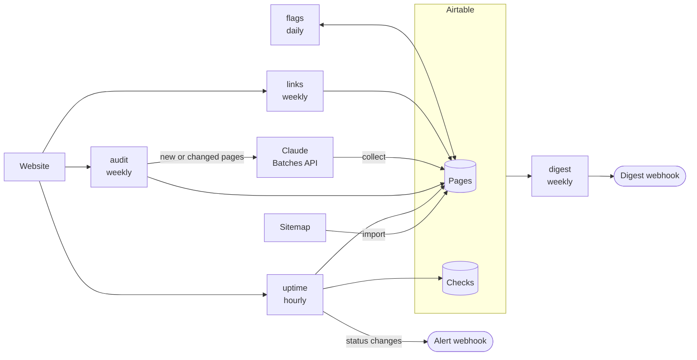

# Chickadee


Chickadee keeps track of what's on a website, what's changed, and what needs attention.

It checks every page each hour and sends an alert when one goes down. Each week it notices which pages have changed, and has Claude summarize them, tag them by topic and review how easy they are to find. It checks every link, flags pages that are stale, broken or missing the basics, and sends a weekly digest of all of it. Everything lands in Airtable, where it's easy to sort, filter and share.

I've spent years building and maintaining websites, and the problems that matter most are usually quiet: a page that's been down since Saturday, a link that now leads nowhere, an article nobody has touched in three years. I built Chickadee so I'd hear about those without checking every page by hand, and to get properly hands-on with the Airtable and Claude APIs along the way.

## Why Chickadee?

I'm a birder, and chickadees are the forest's early warning system. When a chickadee spots a predator, it sounds an alarm, and the more dangerous the threat, the more "dee" notes it adds to its call. [Researchers found](https://www.sciencenews.org/article/dee-danger-chickadees-add-notes-threat-grows) that a small, dangerous owl can get over twenty. Other birds listen in: [nuthatches eavesdrop on chickadee alarms](https://www.washington.edu/news/2007/03/19/eavesdropping-nuthatches-distinguish-danger-threats-in-chickadee-alarm-calls) and respond to how urgent they sound.

That's the job I wanted this tool to do for a website. Most of the time it just keeps watch quietly, but when something goes wrong, it makes sure the people who need to know hear about it, and how much it matters.

## What it does

- **Uptime:** checks every page hourly, records its status, and sends an alert to any webhook when a page goes down or comes back.
- **Change tracking:** fingerprints each page's content, so it knows exactly which pages changed and when.
- **AI reviews:** sends new and changed pages to Claude for a summary, topic tags, the page's main point, and an SEO review with suggestions. Unchanged pages aren't reviewed again, which keeps costs low.
- **Link checking:** finds broken links in each page's content, keeping links it can't verify separate from ones that are definitely broken.
- **Attention flags:** turns all of that into one to-do list of pages that are down, stale, broken, poorly scored or missing metadata.
- **Weekly digest:** a short report of what's new, what changed and what needs work, emailed to whoever needs it.
- **Sitemap import:** adds pages from a sitemap, with a dry run to preview them first.

## How it works



Airtable is the hub. Each command does one job and writes its results to the page's row, and the flags and the digest read everything back to decide what matters. GitHub Actions runs each command on its own schedule, and alerts and digests go to webhooks, so they can be routed anywhere. I use Make to send them to Discord and email.

## Quick start

You'll need [uv](https://docs.astral.sh/uv/), an Airtable account and a Claude API key.

```bash
git clone https://github.com/reinerb/chickadee.git
cd chickadee
uv sync
```

Then set up the Airtable base and your `.env` file by following [docs/setup.md](docs/setup.md). Once that's done:

```bash
uv run chickadee import https://example.org/sitemap.xml --dry-run   # preview
uv run chickadee import https://example.org/sitemap.xml --limit 20  # add 20 pages
uv run chickadee uptime                                             # check them
uv run chickadee audit                                              # send them for review
```

## Commands

| Command | What it does |
|---|---|
| `chickadee import` | Adds pages from a sitemap that aren't being tracked yet |
| `chickadee uptime` | Checks every active page, records its status, and sends alerts for changes |
| `chickadee audit` | Reads each page, records what changed, and sends new or changed pages to Claude |
| `chickadee collect` | Saves finished reviews from Claude |
| `chickadee links` | Checks the links in each page's main content |
| `chickadee flags` | Flags pages that need attention |
| `chickadee digest` | Writes the weekly digest and emails it |
| `chickadee prune` | Deletes logged checks older than the retention period |
| `chickadee test-alert` | Sends a sample alert to the alert webhook |

Run `chickadee --help`, or any command with `--help`, to see its options.

## Documentation

- **[Setup](docs/setup.md):** building the Airtable base, credentials, your first run, and everyday use.
- **[Configuration](docs/configuration.md):** every setting, and how to choose storage settings for your Airtable plan.
- **[Airtable schema](docs/airtable-schema.md):** every table and field.
- **[Webhooks](docs/webhooks.md):** the alert and digest payloads, and the sample Make scenarios.
- **[Automation](docs/automation.md):** the scheduled GitHub Actions workflows and how credentials are kept safe.
- **[Design](docs/design.md):** how each part works, why it works that way, and known limitations.
- **[Development](docs/development.md):** tools, tests, and how the code is organized.

## Built with

Python, [uv](https://docs.astral.sh/uv/), [Airtable](https://airtable.com/) via [pyAirtable](https://pyairtable.readthedocs.io/), the [Claude API](https://platform.claude.com/docs) with structured outputs and message batches, [httpx](https://www.python-httpx.org/), [Beautiful Soup](https://www.crummy.com/software/BeautifulSoup/), [Pydantic](https://docs.pydantic.dev/), GitHub Actions, and [Make](https://www.make.com/) for routing alerts and email.
